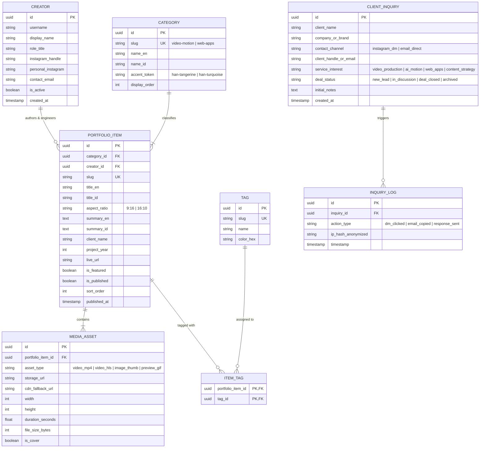

# hanvisuals: Entity Relationship Diagram (ERD) & Data Schema Specification

**Version**: 1.0.0  
**Target Environment**: Next.js App Router (Phase 1 Static Contract) & Supabase PostgreSQL (Phase 2 CRM & CMS Engine)  
**Standard**: Anti-Slop Architecture (Zero-Redundancy, Strict Typing, RLS-Hardened)

---

## 1. Arsitektur Relasi Entitas (High-Level Overview)

Sistem data `hanvisuals` dirancang modular dalam 2 tingkat operasional:
1. **Presentation Layer (Phase 1)**: Skema typed-object yang mengonsumsi metadata karya visual 9:16 dan rekayasa web secara instan tanpa latensi database.
2. **Relational Backend Layer (Phase 2)**: Skema PostgreSQL di Supabase untuk menampung leads calon klien (*Project Inquiries*), audit aset video, dan analitik interaksi konversi.

### 1.1 Diagram Relasi (Mermaid ERD)



---

## 2. Kamus Data & Definisi Entitas (Data Dictionary)

### 2.1 Entitas `PORTFOLIO_ITEM` (Katalog Karya Utama)
Tabel sentral yang menyimpan seluruh showcase, membedakan spesifikasi teknis karya vertikal 9:16 dan aplikasi web desktop 16:10.

| Atribut | Tipe Data | Nullable | Default | Deskripsi & Validasi |
|---|---|---|---|---|
| `id` | `UUID` | No | `gen_random_uuid()` | Primary Key unik. |
| `category_id` | `UUID` | No | - | Foreign Key ke tabel `CATEGORY`. |
| `creator_id` | `UUID` | No | - | Foreign Key ke tabel `CREATOR` (Ihan). |
| `slug` | `VARCHAR(120)` | No | - | URL-friendly slug unik (contoh: `cinematic-streetwear-reel`). |
| `title_en` | `VARCHAR(150)` | No | - | Judul karya versi Bahasa Inggris. |
| `title_id` | `VARCHAR(150)` | No | - | Judul karya versi Bahasa Indonesia. |
| `aspect_ratio` | `VARCHAR(10)` | No | `'9:16'` | Enforce constraint: `CHECK (aspect_ratio IN ('9:16', '16:10', '1:1'))`. |
| `summary_en` | `TEXT` | Yes | `NULL` | Ringkasan narasi karya (EN). |
| `summary_id` | `TEXT` | Yes | `NULL` | Ringkasan narasi karya (ID). |
| `client_name` | `VARCHAR(100)` | Yes | `'Independent / Spec'` | Nama brand/klien. |
| `project_year` | `INT2` | No | `2026` | Tahun produksi. |
| `live_url` | `TEXT` | Yes | `NULL` | Tautan proyek aktif (wajib untuk item berformat `16:10`). |
| `is_featured` | `BOOLEAN` | No | `false` | Menampilkan item di Hero / Top Grid. |
| `is_published` | `BOOLEAN` | No | `true` | Status publikasi situs publik. |
| `sort_order` | `INT2` | No | `0` | Urutan tampil manual pada filter antarmuka. |
| `published_at` | `TIMESTAMPTZ`| No | `NOW()` | Timestamp publikasi karya. |

---

### 2.2 Entitas `MEDIA_ASSET` (Media & Video Player Optimization)
Mengatur penyimpanan dan pengiriman video performa tinggi (9:16 MP4 / HLS Stream) serta fallback gambar cover.

| Atribut | Tipe Data | Nullable | Default | Deskripsi & Validasi |
|---|---|---|---|---|
| `id` | `UUID` | No | `gen_random_uuid()` | Primary Key. |
| `portfolio_item_id` | `UUID` | No | - | FK relasi ke `PORTFOLIO_ITEM`. Cascade on delete. |
| `asset_type` | `VARCHAR(30)` | No | `'video_mp4'` | Enum: `video_mp4`, `video_hls`, `image_thumb`, `preview_gif`. |
| `storage_url` | `TEXT` | No | - | Direct path (lokal `/videos/...` atau cloud CDN). |
| `cdn_fallback_url`| `TEXT` | Yes | `NULL` | Jalur alternatif jika server utama mengalami downtime. |
| `width` | `INT4` | No | `1080` | Resolusi piksel horizontal (contoh: 1080 untuk 9:16). |
| `height` | `INT4` | No | `1920` | Resolusi piksel vertikal (contoh: 1920 untuk 9:16). |
| `duration_seconds`| `NUMERIC(5,2)`| Yes | `NULL` | Durasi video (contoh: `15.50` detik). |
| `file_size_bytes` | `INT8` | Yes | `NULL` | Ukuran file byte untuk lazy-loading evaluation. |
| `is_cover` | `BOOLEAN` | No | `false` | Menandai apakah aset ini poster cover default. |

---

### 2.3 Entitas `CLIENT_INQUIRY` (Leads & Direct Deal Pipeline)
Menampung calon klien yang menekan tombol aksi konversi (DM / Email) atau mengisi quick-lead saat Supabase aktif.

| Atribut | Tipe Data | Nullable | Default | Deskripsi & Validasi |
|---|---|---|---|---|
| `id` | `UUID` | No | `gen_random_uuid()` | Primary Key. |
| `client_name` | `VARCHAR(100)` | Yes | `'Anonymous Lead'` | Nama calon klien / brand rep. |
| `company_or_brand`| `VARCHAR(100)` | Yes | `NULL` | Nama perusahaan atau akun medsos brand. |
| `contact_channel` | `VARCHAR(30)` | No | `'instagram_dm'` | Enum: `instagram_dm`, `email_direct`. |
| `client_handle_or_email` | `VARCHAR(120)` | Yes | `NULL` | Kontak klien jika diisi (email / @username). |
| `service_interest`| `VARCHAR(50)` | No | `'video_production'` | `video_production`, `ai_motion`, `web_apps`, `content_strategy`. |
| `deal_status` | `VARCHAR(30)` | No | `'new_lead'` | Status alur: `new_lead`, `in_discussion`, `deal_closed`, `archived`. |
| `initial_notes` | `TEXT` | Yes | `NULL` | Catatan brief singkat atau estimasi proyek. |
| `created_at` | `TIMESTAMPTZ`| No | `NOW()` | Waktu pertama aksi konversi dipicu. |

---

## 3. Kontrak Objek Frontend, Fase 1 (`portfolioData.js`)

Untuk implementasi instan tanpa overhead koneksi database di awal, skema di atas dicerminkan 1:1 ke dalam kontrak data statis JavaScript murni:

```javascript
// src/data/portfolioData.js

/**
 * @typedef {Object} MediaAsset
 * @property {'video_mp4' | 'image_thumb'} type
 * @property {string} url
 * @property {number} width
 * @property {number} height
 * @property {boolean} isCover
 */

/**
 * @typedef {Object} PortfolioItem
 * @property {string} id
 * @property {'video' | 'web'} category
 * @property {'9:16' | '16:10'} aspectRatio
 * @property {string} titleEn
 * @property {string} titleId
 * @property {string} deliverablesEn
 * @property {string} deliverablesId
 * @property {string} client
 * @property {string} year
 * @property {string} [liveUrl]
 * @property {string} [videoSource]
 * @property {string} thumbnailUrl
 * @property {string[]} tags
 * @property {string} accentToken // 'han-tangerine' | 'han-turquoise' | 'han-yellow' | 'han-coral'
 * @property {boolean} isFeatured
 */

export const portfolioData = [
  {
    id: "proj-vertical-01",
    category: "video",
    aspectRatio: "9:16",
    titleEn: "Cinematic Streetwear Pacing",
    titleId: "Iklan Sinematik Apparel",
    deliverablesEn: "9:16 Video Editing, Sound Design, Color Grading",
    deliverablesId: "Editing Video 9:16, Tata Suara, Color Grading",
    client: "Spec Project / Apex Streetwear",
    year: "2026",
    videoSource: "/videos/placeholder-reel-1.mp4",
    thumbnailUrl: "/placeholders/reel-thumb-1.jpg",
    tags: ["9:16 Video", "High Retention", "Color Grade"],
    accentToken: "han-tangerine",
    isFeatured: true
  },
  {
    id: "proj-motion-02",
    category: "video",
    aspectRatio: "9:16",
    titleEn: "Generative AI Brand Portal",
    titleId: "Motion Portal AI Generatif",
    deliverablesEn: "AI Motion Design, Kinetic Typography, 3D Fluid",
    deliverablesId: "Desain Motion AI, Tipografi Kinetik, 3D Fluid",
    client: "hanvisuals Labs",
    year: "2026",
    videoSource: "/videos/placeholder-reel-2.mp4",
    thumbnailUrl: "/placeholders/reel-thumb-2.jpg",
    tags: ["AI Motion", "ComfyUI", "Kinetic"],
    accentToken: "han-yellow",
    isFeatured: true
  },
  {
    id: "proj-web-03",
    category: "web",
    aspectRatio: "16:10",
    titleEn: "Apex Enterprise Cloud Platform",
    titleId: "Platform Web Korporat Modern",
    deliverablesEn: "Full-Stack Web App, Next.js Engine, Tailwind Architecture",
    deliverablesId: "Aplikasi Web Interaktif, Mesin Next.js, Arsitektur Tailwind",
    client: "Nexus Global Tech",
    year: "2026",
    liveUrl: "https://example.com",
    thumbnailUrl: "/placeholders/web-thumb-1.jpg",
    tags: ["Next.js", "Tailwind CSS", "Enterprise Web"],
    accentToken: "han-turquoise",
    isFeatured: true
  }
];
```

---

## 4. Skrip DDL Supabase PostgreSQL, Fase 2 (Production Ready)

Saat kamu siap mengaktifkan Supabase, cukup jalankan skrip SQL DDL ini pada panel **Supabase SQL Editor**:

```sql
-- 1. EXTENSIONS & SCHEMAS
CREATE EXTENSION IF NOT EXISTS "uuid-ossp";

-- 2. CREATE CATEGORIES TABLE
CREATE TABLE public.categories (
    id UUID PRIMARY KEY DEFAULT uuid_generate_v4(),
    slug VARCHAR(50) UNIQUE NOT NULL,
    name_en VARCHAR(100) NOT NULL,
    name_id VARCHAR(100) NOT NULL,
    accent_token VARCHAR(30) NOT NULL DEFAULT 'han-turquoise',
    display_order INT2 NOT NULL DEFAULT 0,
    created_at TIMESTAMPTZ DEFAULT NOW()
);

-- 3. CREATE CREATOR TABLE
CREATE TABLE public.creators (
    id UUID PRIMARY KEY DEFAULT uuid_generate_v4(),
    username VARCHAR(50) UNIQUE NOT NULL,
    display_name VARCHAR(100) NOT NULL,
    instagram_handle VARCHAR(50) NOT NULL,
    personal_instagram VARCHAR(50) NOT NULL,
    contact_email VARCHAR(100) NOT NULL,
    is_active BOOLEAN NOT NULL DEFAULT true,
    created_at TIMESTAMPTZ DEFAULT NOW()
);

-- 4. CREATE PORTFOLIO_ITEMS TABLE
CREATE TABLE public.portfolio_items (
    id UUID PRIMARY KEY DEFAULT uuid_generate_v4(),
    category_id UUID NOT NULL REFERENCES public.categories(id) ON DELETE RESTRICT,
    creator_id UUID NOT NULL REFERENCES public.creators(id) ON DELETE RESTRICT,
    slug VARCHAR(120) UNIQUE NOT NULL,
    title_en VARCHAR(150) NOT NULL,
    title_id VARCHAR(150) NOT NULL,
    aspect_ratio VARCHAR(10) NOT NULL DEFAULT '9:16' CHECK (aspect_ratio IN ('9:16', '16:10', '1:1')),
    summary_en TEXT,
    summary_id TEXT,
    client_name VARCHAR(100) DEFAULT 'Independent Project',
    project_year INT2 NOT NULL DEFAULT 2026,
    live_url TEXT,
    is_featured BOOLEAN NOT NULL DEFAULT false,
    is_published BOOLEAN NOT NULL DEFAULT true,
    sort_order INT2 NOT NULL DEFAULT 0,
    published_at TIMESTAMPTZ DEFAULT NOW(),
    created_at TIMESTAMPTZ DEFAULT NOW()
);

-- 5. CREATE MEDIA_ASSETS TABLE
CREATE TABLE public.media_assets (
    id UUID PRIMARY KEY DEFAULT uuid_generate_v4(),
    portfolio_item_id UUID NOT NULL REFERENCES public.portfolio_items(id) ON DELETE CASCADE,
    asset_type VARCHAR(30) NOT NULL CHECK (asset_type IN ('video_mp4', 'video_hls', 'image_thumb', 'preview_gif')),
    storage_url TEXT NOT NULL,
    cdn_fallback_url TEXT,
    width INT4 NOT NULL DEFAULT 1080,
    height INT4 NOT NULL DEFAULT 1920,
    duration_seconds NUMERIC(5,2),
    file_size_bytes INT8,
    is_cover BOOLEAN NOT NULL DEFAULT false,
    created_at TIMESTAMPTZ DEFAULT NOW()
);

-- 6. CREATE CLIENT_INQUIRIES TABLE (CRM Leads)
CREATE TABLE public.client_inquiries (
    id UUID PRIMARY KEY DEFAULT uuid_generate_v4(),
    client_name VARCHAR(100) DEFAULT 'Anonymous Lead',
    company_or_brand VARCHAR(100),
    contact_channel VARCHAR(30) NOT NULL CHECK (contact_channel IN ('instagram_dm', 'email_direct')),
    client_handle_or_email VARCHAR(120),
    service_interest VARCHAR(50) NOT NULL DEFAULT 'video_production',
    deal_status VARCHAR(30) NOT NULL DEFAULT 'new_lead' CHECK (deal_status IN ('new_lead', 'in_discussion', 'deal_closed', 'archived')),
    initial_notes TEXT,
    created_at TIMESTAMPTZ DEFAULT NOW()
);

-- 7. ROW LEVEL SECURITY (RLS) POLICIES
ALTER TABLE public.categories ENABLE ROW LEVEL SECURITY;
ALTER TABLE public.portfolio_items ENABLE ROW LEVEL SECURITY;
ALTER TABLE public.media_assets ENABLE ROW LEVEL SECURITY;
ALTER TABLE public.client_inquiries ENABLE ROW LEVEL SECURITY;

-- Public can READ published portfolio items & media
CREATE POLICY "Public Read Published Portfolio" 
ON public.portfolio_items FOR SELECT 
USING (is_published = true);

CREATE POLICY "Public Read Categories" 
ON public.categories FOR SELECT 
USING (true);

CREATE POLICY "Public Read Media Assets" 
ON public.media_assets FOR SELECT 
USING (true);

-- Anyone can submit an inquiry (INSERT only), but cannot view existing ones
CREATE POLICY "Public Insert Inquiry" 
ON public.client_inquiries FOR INSERT 
WITH CHECK (true);

-- Authenticated Admin (Ihan) gets full access
CREATE POLICY "Admin Full Access Portfolio" 
ON public.portfolio_items FOR ALL 
TO authenticated 
USING (true) WITH CHECK (true);

CREATE POLICY "Admin Full Access Inquiries" 
ON public.client_inquiries FOR ALL 
TO authenticated 
USING (true) WITH CHECK (true);
```

---

## 5. Ringkasan & Langkah Penerapan

1. **Untuk Saat Ini (MVP)**: Cukup gunakan skema pada **Seksi 3 (`portfolioData.js`)**. File ini akan diimpor langsung oleh komponen `Showcase.js`, membuat loading video instan tanpa perlu repot setup akun Supabase.
2. **Untuk Masa Depan (Skala Agensi)**: Jalankan query DDL pada **Seksi 4** di Supabase untuk mengaktifkan database relasional terproteksi RLS dalam 30 detik.